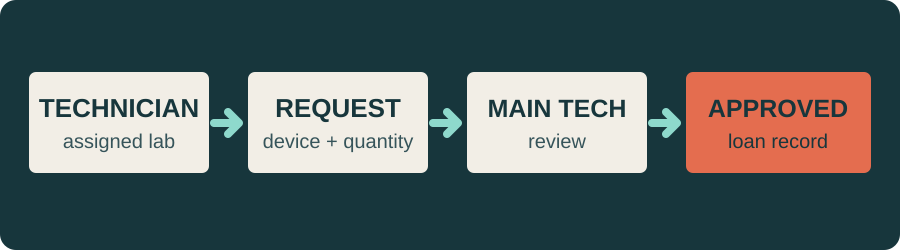
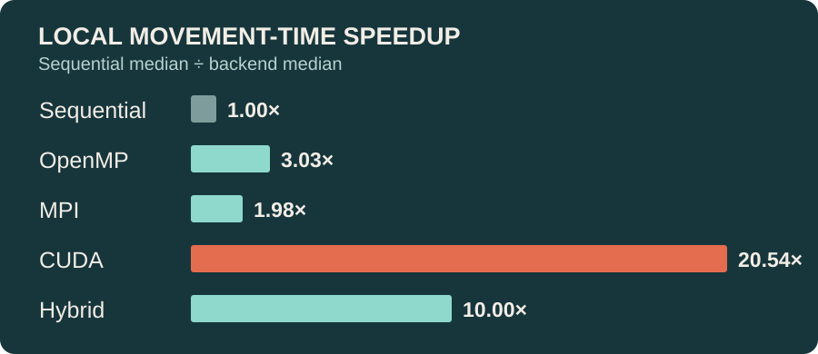

<picture>
  <source media="(prefers-color-scheme: dark)" srcset="assets/profile-cover-dark.svg">
  
</picture>

### Software for spaces, workflows, and scale.

Parking spaces. Lab equipment. Pedestrian movement. My projects turn each into a system that can be mapped, tracked, or measured. I’m a Computer Science and Engineering student working across full-stack applications, AWS infrastructure, computer vision, and parallel computing.

**[Projects](#selected-work)** &nbsp;·&nbsp; **[Experience](#experience)** &nbsp;·&nbsp; **[Currently](#currently)** &nbsp;·&nbsp; **[Contact](#contact)**

## Selected work

### [ParkEase](https://github.com/Dwijeshh/ParkEase)

**Parking navigation and occupancy monitoring**

A prototype for parking facilities with multiple entrances. It represents the facility as a graph, assigns an available slot for a chosen destination, and shows the route in a Flutter app. Computer vision supports parking-bay occupancy monitoring.

**Result:** [X] ms median allocation-and-route response time across 100 valid requests on the same demo floor plan.

`Flutter` &nbsp; `Node.js / Express` &nbsp; `PostgreSQL` &nbsp; `OpenCV`

### [Lab Asset Management](https://github.com/Dwijeshh/lab_asset_management2)

**A clearer view of equipment across institutions**

A web application for MAHE laboratory staff to manage inventory, export asset lists, request loans and transfers, and track approvals through role-based workflows and an audit trail.

**Result:** [X] assets searchable in the seeded MAHE demo inventory.

`Next.js` &nbsp; `TypeScript` &nbsp; `PostgreSQL` &nbsp; `Drizzle ORM`

### [Parallel Crowd-Crush Risk Simulation](https://github.com/Dwijeshh/pcap-crowd-crush-simulation)

**One movement model, five computing backends**

A collaborative pedestrian simulation comparing sequential CPU, OpenMP, MPI, CUDA, and hybrid implementations. I contributed the OpenMP backend, shared metrics, hybrid integration, the live comparison interface, benchmarks, and report studies.

**Result:** [X]× CUDA movement-time speedup over sequential for 5,000 pedestrians and 100 steps.

The chart uses [documented local medians](https://github.com/Dwijeshh/pcap-crowd-crush-simulation#results-at-a-glance) from one RTX 3050 laptop. Backend timing scopes differ, so the ratios describe that benchmark rather than identical end-to-end run times. The simulation’s risk labels are model indicators and have not been calibrated to real-world injury outcomes.

`C++` &nbsp; `OpenMP` &nbsp; `MPI` &nbsp; `CUDA`

## Experience

**AWS Cloud Solution Architect Intern** · CloudCapt Technologies  
*January–April 2025*

- Worked with EC2, S3, VPC, RDS, Application Load Balancer, IAM, and security groups.
- Deployed websites, configured domains and SSL certificates, and designed a three-tier cloud architecture.

## Technical depth

- **Strong:** TypeScript, Next.js, PostgreSQL, AWS deployment.
- **Working knowledge:** Node.js/Express, Flutter, Python, Docker, Linux, OpenMP, OpenCV.
- **Exploring:** MPI, CUDA, PyTorch, TensorFlow.

## Currently

- **Building:** [current project or feature]
- **Learning:** [specific topic]
- **Looking for:** [role, collaboration, or “not currently looking”]

## Recently updated

<!-- recent-repos:start -->
- [ParkEase](https://github.com/Dwijeshh/ParkEase) — last pushed 5 Nov 2026
- [Parallel Crowd-Crush Risk Simulation](https://github.com/Dwijeshh/pcap-crowd-crush-simulation) — last pushed 5 Nov 2026
- [Lab Asset Management](https://github.com/Dwijeshh/lab_asset_management2) — last pushed 5 Nov 2026
<!-- recent-repos:end -->

Refreshed weekly from GitHub repository activity.

## Contact

[Email](mailto:rorozoro701@gmail.com) · [LinkedIn](https://linkedin.com/in/meowmeowww)
