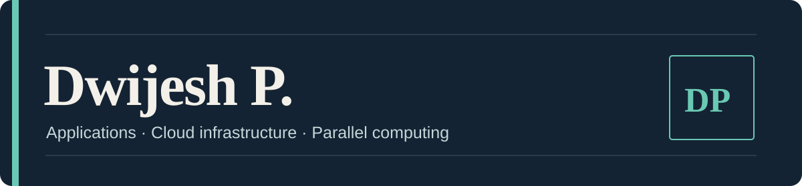
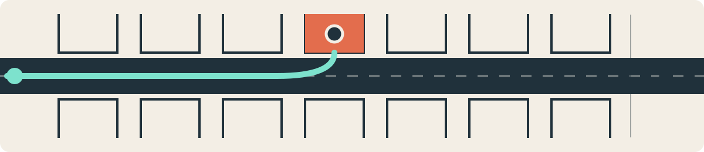
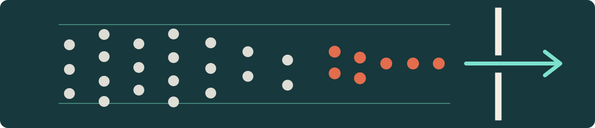

Parking spaces. Lab equipment. Pedestrian movement. My projects turn each into a system that can be mapped, tracked, or measured. I’m a Computer Science and Engineering student working across full-stack applications, AWS infrastructure, computer vision, and parallel computing.

**[Projects](#selected-work)** &nbsp;·&nbsp; **[Experience](#experience)** &nbsp;·&nbsp; **[Contact](#contact)**

## Selected work

### [ParkEase](https://github.com/Dwijeshh/ParkEase)

**Parking navigation and occupancy monitoring**

A prototype for parking facilities with multiple entrances. It represents the facility as a graph, assigns an available slot for a chosen destination, and shows the route in a Flutter app. Computer vision supports parking-bay occupancy monitoring.

`Flutter` &nbsp; `Node.js / Express` &nbsp; `PostgreSQL` &nbsp; `OpenCV`

### [Lab Asset Management](https://github.com/Dwijeshh/lab_asset_management2)

**A clearer view of equipment across institutions**

A web application for MAHE laboratory staff to manage inventory, export asset lists, request loans and transfers, and track approvals through role-based workflows and an audit trail.

`Next.js` &nbsp; `TypeScript` &nbsp; `PostgreSQL` &nbsp; `Drizzle ORM`

### [Parallel Crowd-Crush Risk Simulation](https://github.com/Dwijeshh/pcap-crowd-crush-simulation)

**One movement model, five computing backends**

A collaborative pedestrian simulation comparing sequential CPU, OpenMP, MPI, CUDA, and hybrid implementations. I contributed the OpenMP backend, shared metrics, hybrid integration, the live comparison interface, benchmarks, and report studies.

`C++` &nbsp; `OpenMP` &nbsp; `MPI` &nbsp; `CUDA`

*The simulation’s risk labels are model indicators and have not been calibrated to real-world injury outcomes.*

## Experience

**AWS Cloud Solution Architect Intern** · CloudCapt Technologies  
*January–April 2025*

- Worked with EC2, S3, VPC, RDS, Application Load Balancer, IAM, and security groups.
- Deployed websites, configured domains and SSL certificates, and designed a three-tier cloud architecture.

## Technical range

| Area | Technologies |
| :--- | :--- |
| Application development | Java, Python, JavaScript, TypeScript, PHP, SQL, React, Next.js, Node.js, Flutter |
| Data and infrastructure | PostgreSQL, MySQL, AWS, Docker, Linux, Apache2, Nginx, Git |
| Computing and vision | OpenMP, MPI, CUDA, OpenCV, PyTorch, TensorFlow |

## Contact

[Email](mailto:dwijeshamin@gmail.com) · [LinkedIn](https://linkedin.com/in/meowmeowww)
