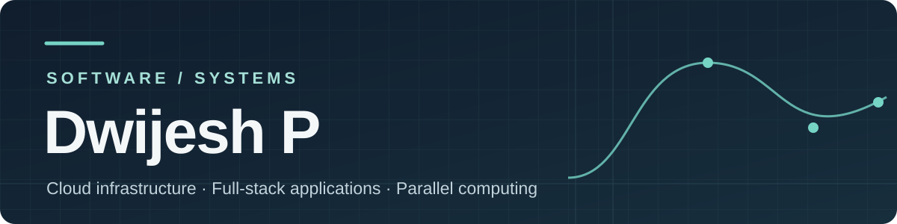

### I build software that meets the physical world.

I'm a Computer Science and Engineering student working across full-stack development, cloud infrastructure, and parallel computing. My recent projects tackle parking navigation, laboratory asset workflows, and pedestrian simulation.

[Explore my work](#work-in-focus) · [Connect with me](#connect)

---

## Work in focus

### 01 / [ParkEase](https://github.com/Dwijeshh/ParkEase) — finding the right space

A prototype for parking facilities with multiple entrances. It models the facility as a graph, allocates an available slot based on the driver's destination, and displays a route in a Flutter app. A computer-vision component supports occupancy monitoring.

`Flutter` · `Node.js / Express` · `PostgreSQL` · `OpenCV`

### 02 / [Lab Asset Management](https://github.com/Dwijeshh/lab_asset_management2) — making equipment visible

A system for managing laboratory assets across MAHE institutions. Staff can track inventory, export asset lists, request loans and transfers, and follow approvals and changes through role-based workflows.

`Next.js` · `TypeScript` · `PostgreSQL` · `Drizzle ORM`

### 03 / [Parallel Crowd-Crush Risk Simulation](https://github.com/Dwijeshh/pcap-crowd-crush-simulation) — comparing ways to compute

A collaborative pedestrian simulation with sequential CPU, OpenMP, MPI, CUDA, and hybrid backends. I contributed the OpenMP backend, shared metrics, hybrid integration, live comparison interface, benchmarks, and report studies.

`C++` · `OpenMP` · `MPI` · `CUDA`

*The simulation's risk labels are model indicators; they have not been calibrated to real pedestrian injury outcomes.*

---

## Beyond the projects

**AWS Cloud Solution Architect Intern · CloudCapt Technologies**  
January–April 2025

Worked with EC2, S3, VPC, RDS, Application Load Balancer, IAM, and security groups. I deployed websites, configured domains and SSL certificates, and designed a three-tier cloud architecture.

## Tools I use

| Building applications | Infrastructure and computing |
| --- | --- |
| Java, Python, JavaScript, TypeScript, PHP, SQL | AWS, Docker, Linux, Git |
| React, Next.js, Node.js, Flutter | OpenMP, MPI, CUDA, OpenCV |
| PostgreSQL, MySQL | Apache2, Nginx, PyTorch, TensorFlow |

## Connect

[Email](mailto:dwijeshamin@gmail.com) · [LinkedIn](https://linkedin.com/in/meowmeowww)
